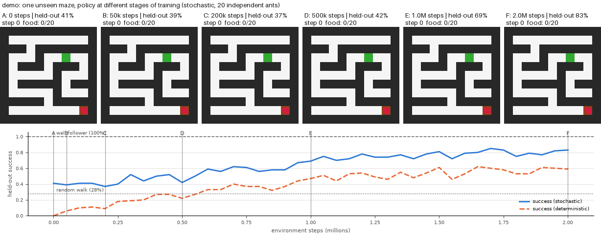
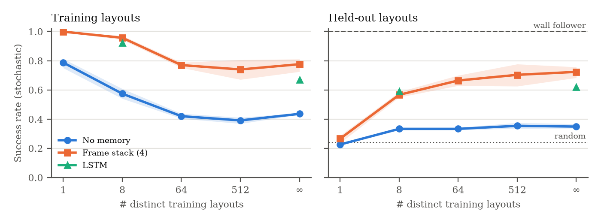

# ANTS-RL: Partially Observable Maze Foraging with PPO

[](https://github.com/Bishwaswarup/ANTS_RL/actions/workflows/tests.yml)
[](https://python.org)
[](https://gymnasium.farama.org)
[](https://stable-baselines3.readthedocs.io)
[](LICENSE)
[](https://doi.org/10.5281/zenodo.23414928)

<p align="center">
  
  <br><em>One unseen maze, 20 independent copies of the policy at six stages of
  training (0 to 2M steps). Early ants wander and pile up against walls; by
  2M steps they stream from the nest (brown) to the food (green).</em>
</p>

A small, fully reproducible deep-RL testbed: an "ant" with a 7×7 egocentric
view must find food in procedurally generated mazes. The repository
accompanies the preprint in [`paper/`](paper/), an empirical study of three
questions:

1. **Memory.** How much does memory help: none, frame stacking, or an LSTM?
2. **Layout diversity.** How many distinct training mazes does an agent need
   before it navigates *unseen* mazes rather than memorising the training ones?
3. **Reward design.** Sparse reward, exact potential-based shaping, and an
   ad-hoc shaped reward (the original v0 reward).

Every method, learned or hand-coded, is evaluated on the **same fixed set of
held-out maze layouts**. Results are reported as success rate and SPL (success
weighted by path length) with 95% bootstrap confidence intervals over seeds.

---

## Results

PPO, 2M environment steps per run, 5 seeds (LSTM: 3). Success is measured on
**500 unseen maze layouts** (stochastic policy). For reference, a random walk
succeeds 24% of the time and the hand-coded right-hand wall follower 100%
(SPL 0.64).

<p align="center"></p>

| Training mazes | No memory: training mazes | No memory: unseen | Frame stack: training mazes | Frame stack: unseen |
|---|---|---|---|---|
| 1 | 79% | 23% | 100% | 27% |
| 8 | 57% | 33% | 96% | 57% |
| 64 | 42% | 33% | 77% | 66% |
| 512 | 39% | 35% | 74% | 70% |
| ∞ (new maze every episode) | 44% | 35% | 78% | **72%** |

- **Memorisation vs. navigation.** Trained on one maze, the frame-stack agent
  solves it every time but is no better than a random walk on new mazes.
  With 64 or more training mazes the gap between seen and unseen mazes nearly closes.
- **Memory matters.** Without memory, success on unseen mazes stays near 35%
  whatever the training variety. Four stacked frames reach 72%. An LSTM given
  the same budget reaches 62% (∞) and 59% (8 mazes).
- **Reward design matters.** With a fresh maze every episode, exact
  potential-based shaping reaches 75%, against 55% for a sparse reward with step
  cost. The original v0 reward (ad-hoc wall, revisit and Manhattan terms) reaches
  only 31%, and 4% with the deterministic policy.
- **Still far from systematic exploration.** The best learned path efficiency
  (SPL 0.40) is below the wall follower's 0.64, and success drops to about 30%
  on unseen 21×21 mazes.

Full tables with 95% bootstrap confidence intervals: `paper/tables/`,
`results/*/summary.csv`. Regenerate everything with `python scripts/aggregate.py`.

---

## What changed in v0.2 (and why the v0 results were withdrawn)

An audit of v0 found problems that invalidated its headline numbers:

| # | v0 issue | Effect | Fix |
|---|---|---|---|
| 1 | `MazeGenerator.generate()` never reset its grid, so after the first call nothing was carved | Every env instance kept **one fixed maze forever**. Training with 8 envs saw 8 layouts; evaluation used a 9th, unseen one | A new grid is built on every call; layouts are a pure function of a seed |
| 2 | Python's `random` module, which ignores `env.reset(seed=...)` | Runs could not be reproduced | Everything uses `numpy.random.Generator` seeded through Gymnasium |
| 3 | `evaluate.py` reset the render env and the policy env separately | The Pygame window showed **a different maze** from the one the agent acted in | Rendering draws the env the policy acts in |
| 4 | "Reward ≈ 9.6 at convergence / 16-step episodes" | Contradicted by v0's own `models/logs/evaluations.npz`: mean eval reward ≈ −90, mean episode length 270–300 of 300, success 5–20% | Claims removed; all metrics are now computed on held-out layouts |
| 5 | Distance shaping was called "potential-based" | It left out γ, used Manhattan distance (wrong inside a maze), and was combined with a history-dependent revisit penalty, so policy invariance did not hold | `pbrs` preset: exact γΦ(s′)−Φ(s) on geodesic (BFS) distance. The old reward survives as the `legacy` preset for comparison |
| 6 | `min_food_dist` measured in Manhattan distance | Nest and food could sit on opposite sides of one wall yet be many steps apart | Measured as geodesic distance |
| 7 | "View covers < 15% of the maze" | The 7×7 window covers ≈ 40% of an 11×11 grid | Corrected |
| 8 | Hard-coded hyperparameters, an unused YAML file, empty stubs, binaries in git | — | One YAML config with CLI overrides; binaries ignored; Phase-2 prototypes moved to [`experimental/`](experimental/) |

The `reward` experiment includes `legacy` reward + 8 layouts + frame stack.
That configuration reproduces the original v0 training setup, so the paper
can report what v0 *actually* learned.

---

## Install

```bash
git clone https://github.com/Bishwaswarup/ANTS_RL && cd ANTS_RL
python -m venv .venv && source .venv/bin/activate
pip install -e ".[dev]"          # or: pip install -r requirements.txt
pytest -q                        # 30 tests, ~1 min
```

## Quickstart

```bash
# train one agent (frame stack, fresh maze every episode, PBRS reward)
python scripts/train.py

# any config key can be overridden
python scripts/train.py --set agent.memory=lstm env.n_train_mazes=64 seed=2

# hand-coded baselines on the same held-out mazes
python scripts/evaluate.py --baselines

# watch the trained agent (GIF, or --live with pygame)
python scripts/render.py --run runs/single/stack4_mazes0_pbrs_w3/seed0 --gif ant.gif --episodes 3
# (train.py without --run-dir writes to runs/single/<config>/seed<k>;
#  grid runs live in runs/<experiment>/<setting>/seed<k>, e.g.
#  runs/main/memory=stack__n_train_mazes=0/seed0)
```

## Watching the ant learn

Every run saves copies of its policy during training (`output.snapshots`,
default 0, 50k, 200k, 500k and 1M steps, plus the final `model.zip`).
`render_progress.py` replays them on the **same unseen maze**, side by side,
above the run's learning curve. You can see the ant go from bumping into
walls to walking to the food.

```bash
python scripts/train.py --run-dir runs/demo                    # ~25-30 min
python scripts/render_progress.py --run runs/demo --gif progress.gif
python scripts/render_progress.py --run runs/demo --ants 20 --gif swarm_progress.gif
python scripts/render_progress.py --run runs/demo --png progress.png   # static figure

python scripts/render.py --run runs/demo --ants 20 --live      # 20 ants, final policy
python scripts/render.py --run runs/demo --model snapshots/step_00050000.zip --live
```

With `--ants N`, N independent copies of the policy start at the nest. They
cannot see each other, so this shows how varied one ant's behaviour is, not
cooperation. A real colony that shares pheromone trails is the Phase 2 goal
(see `experimental/`).

## Running in sessions (e.g. at most 3 hours at a time)

Runs checkpoint every 100k steps (`output.checkpoint_every`). With
`--max-hours`, a session stops cleanly when its budget is used up: running
runs save a checkpoint and exit, and no new run starts. Re-running the same
command continues where it stopped. Finished runs are skipped and paused runs
resume from their checkpoint.

```bash
# four runs in parallel, 3-hour session
caffeinate -i python scripts/run_experiments.py configs/experiments/main.yaml \
    --jobs 4 --max-hours 3
# ...later, same command again to continue
```

`--subproc` (`ppo.vec_env: subproc`) steps the 8 mazes in 8 processes. On an
M1 MacBook Air it measured *slower* (1,195 vs 1,290 steps/s, 200k-step
benchmark). Stepping this maze is so cheap that inter-process overhead
dominates. Use `--jobs 4` (four runs in parallel, one process each) to keep
the cores busy instead. Both settings give identical results for the same seed.
A resumed run trains for the same number of steps but is not bit-identical
to an uninterrupted one, because the environment random state restarts.

Each run directory contains `config.yaml` (fully resolved), `progress.csv`
(SB3 training log), `curves.csv` (held-out success over training),
`model.zip`, `eval.json` (summary metrics) and `episodes.npz` (per-episode
results, for paired statistics).

---

## Environment

| | |
|---|---|
| Maze | 11×11 grid, *perfect* maze (spanning tree: exactly one path between any two cells), randomised DFS. 49 free cells |
| Observation | `(3, 7, 7)` binary: wall / food / nest, egocentric, out-of-bounds = wall |
| Actions | up, right, down, left. A move into a wall leaves the agent in place |
| Episode | starts at the nest; ends on reaching the food or after 294 steps (6 × free cells) |
| Layouts | `n_train_mazes: N` → a fixed pool of N layouts; `0` → a fresh layout every episode. Nest and food are re-sampled every episode. Each layout is assigned to a train or test split by a hash of the layout itself (1 in 10 is test); training never uses test layouts and held-out evaluation uses only test layouts |

Reward presets (`env.reward.preset`):

| Preset | Definition |
|---|---|
| `sparse` | +1 on reaching food, −0.01 per step |
| `pbrs` (default) | sparse (incl. −0.01/step) + γΦ(s′) − Φ(s), with Φ(s) = −d(s)/D, where d is the BFS distance to the food and D the maximum such distance in the maze. Φ = 0 at the goal ⇒ policy-invariant (Ng et al., 1999). The step cost c ≥ 1−γ stops PBRS from paying for standing still (the pilot agent learned to push into walls without it) |
| `legacy` | v0 reward: −0.01/step, −0.1/wall hit, +0.15·ΔManhattan, −0.05·min(visits−1, 5), +10 on food. **Not** policy-invariant |

Baselines (`ants_rl/baselines.py`): **random walk**; **wall follower**
(right-hand rule: uses only the 4 adjacent cells plus a heading, and is
guaranteed to succeed in a perfect maze); **oracle** (true shortest path,
SPL = 1).

Held-out reference numbers (500 test-split layouts, 11×11; regenerate with
`python scripts/evaluate.py --baselines`, which writes `results/baselines.json`;
the paper's table is generated from that file by `scripts/aggregate.py`):

| Baseline | Success | SPL |
|---|---|---|
| Random walk | 24.2% | 0.025 |
| Wall follower | 100% | 0.644 |
| Oracle | 100% | 1.000 |

---

## Reproducing the paper

```bash
# 1. list what will run
python scripts/run_experiments.py configs/experiments/main.yaml --dry-run

# 2. run (resumable: finished runs are skipped)
python scripts/run_experiments.py configs/experiments/main.yaml   --jobs 4
python scripts/run_experiments.py configs/experiments/main_lstm.yaml --jobs 4
python scripts/run_experiments.py configs/experiments/reward.yaml --jobs 4
python scripts/run_experiments.py configs/experiments/window.yaml --jobs 4
python scripts/evaluate.py --baselines

# 3. tables -> paper/tables/, figures -> paper/figures/, CSVs -> results/
python scripts/aggregate.py

# 4. build the paper
cd paper && latexmk -pdf main.tex
```

| Experiment | Grid | Runs (5 seeds) |
|---|---|---|
| `main` | memory {none, stack} × train layouts {1, 8, 64, 512, ∞} | 50 |
| `main_lstm` | LSTM × train layouts {8, ∞} (3 seeds; same output folder as `main`) | 6 |
| `reward` | reward {sparse, pbrs, legacy} × train layouts {8, ∞}, frame stack | 30 |
| `window` | window radius {1, 2, 3} (3×3 to 7×7 view), frame stack, ∞ layouts | 15 |
| `memory_size` | LSTM hidden units {1, 2, 4, 8, 64}, ∞ layouts | 25 |
| `braid` (optional) | train on braided mazes (`env.braid=0.5`), memory {stack, lstm} | 6 (3 seeds) |

**Compute.** Every run is 2M env steps (chosen by a pilot; see the paper).
Measured on an M1 MacBook Air with 1 torch thread per run: PPO (none/stack)
runs at about 1,350 env steps/s alone and about 900 steps/s each with 3
runs in parallel, so a 2M-step run takes about 25–40 min. RecurrentPPO (LSTM)
runs at about 190 steps/s, roughly 3 h per run. The `main` grid without LSTM
(50 runs) is about 8 h with `--jobs 4`. The LSTM runs dominate everything
else. Use `--jobs` up to your core count. `--shard i/n` splits a
grid across cluster jobs. For a quick pilot, add
`--set ppo.total_timesteps=200000`.

`configs/experiments/smoke.yaml` runs the whole pipeline in a couple of minutes.

### Extension studies

```bash
# Loops out-of-distribution: braided mazes (env.braid = P(dead end is opened)).
# The wall follower is only guaranteed on perfect mazes; how do learned agents cope?
python scripts/eval_braid.py --runs "runs/main/memory=lstm__n_train_mazes=0/seed*" \
                                    "runs/main/memory=stack__n_train_mazes=0/seed*"

# Minimum memory: LSTM hidden-size sweep (the wall follower needs ~2 bits)
python scripts/run_experiments.py configs/experiments/memory_size.yaml --jobs 6

# What did the LSTM learn? Linear probes on the hidden state, with controls
python scripts/probe_lstm.py --run "runs/main/memory=lstm__n_train_mazes=0/seed*"

python scripts/analyze_extras.py     # -> paper/figures/{braid,memory_size,probe}.*, paper/tables/*.tex
```

---

## Repository layout

```
ants_rl/
  maze.py          maze generation (DFS / Prim), BFS distances, entity placement
  env.py           AntMazeEnv + reward presets
  policy.py        CNN feature extractors (SB3)
  baselines.py     random / wall-follower / oracle
  evaluation.py    batched evaluation on fixed episode sets, SPL, frame stacker
  training.py      model construction, checkpoint/resume, snapshots, eval protocol
  viz.py           multi-ant rollouts and frame drawing for the renderers
  config.py        YAML + dotted CLI overrides
scripts/           train, evaluate, run_experiments, aggregate, render, render_progress
configs/           default.yaml + experiments/*.yaml
tests/             maze validity, seeding, observation, PBRS telescoping, pipeline
paper/             LaTeX preprint (tables/figures generated by aggregate.py)
docs/media/        README images and animations
.github/workflows/ CI: runs the test suite on every push
experimental/      untested Phase-2 prototypes (pheromones, comms)
```

## Roadmap

- [x] v0.2: bug fixes, reproducible pipeline, held-out evaluation, baselines
- [x] Main grid (memory × training mazes, 80 runs) and reward ablation (30 runs)
- [ ] Field-of-view experiment (`window.yaml`, 15 runs)
- [ ] Preprint draft and `v0.2.0` release with a Zenodo DOI
- [ ] Phase 2: multi-ant foraging with shared pheromone trails (`experimental/colony/`, pilot does not learn yet)

### Colony pilot add-on

An optional, integrated colony study is available in
[`experimental/colony/`](experimental/colony/). It adds a shared-pheromone
Gymnasium environment and PPO runner that reuse the project's seeded maze
generator. It does not change the Phase-1 environment or its results. See the
colony README for the pilot command, assumptions, and limitations.

## Citation

GitHub's "Cite this repository" button uses [`CITATION.cff`](CITATION.cff).

```bibtex
@misc{bishwaswarup2026antsrl,
  author       = {Bishwaswarup},
  title        = {Memory, Layout Diversity and Reward Shaping in Partially Observable
                  Maze Foraging: A Reproducible Small-Scale Study},
  year         = {2026},
  howpublished = {\url{https://github.com/Bishwaswarup/ANTS_RL}},
  note         = {Preprint}
}
```

**Author:** Bishwaswarup, Department of Physics, Indian Institute
of Science, Bangalore. Licensed under MIT.
